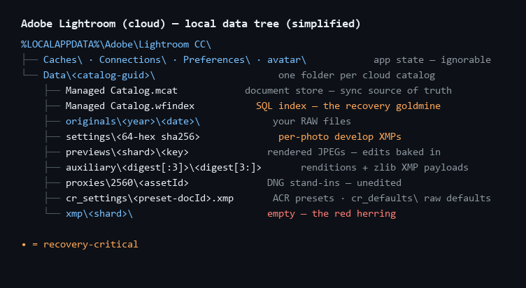

# Lightroom Cloud Local Recovery

Recover your **edits** — develop settings (XMP), rendered versions, and
presets — from the **local cache of Adobe Lightroom (cloud version)**,
without the Lightroom app, without an Adobe account, without any
entitlement. Works after your subscription ended, your license was
revoked, your account was dropped from an organization, or you simply
can't sign in anymore.

Why edits come first: the originals you imported are files you already
own — if your memory cards or drives are intact, Adobe's cached copy is
only a convenience. The edits, renders, and presets, however, were
*created inside Lightroom* and exist nowhere else. That is the data a
lockout actually destroys, and what this toolkit rescues.

Battle-tested on a real lockout: full develop settings (XMP) for every
edited photo, 303 edited JPEG renders, and 234 presets — plus, as a
bonus, a sha256-verified second copy of all 1,692 originals (64 GB).

## Quick start (Windows, tested)

```bat
pip install numpy pillow
python run_all.py --out D:\MyRecovery
```

Everything auto-discovers: the data root from `%LOCALAPPDATA%`, the
catalog GUID by looking for `Managed Catalog.mcat`. Override with
`--data` if your library lives elsewhere.

## How the recovery works — the discovery order

### 1. Start with the tree, not the app

The app is locked; the cache isn't. Look at what's actually on disk
under `%LOCALAPPDATA%\Adobe\Lightroom CC\Data\<guid>\`:



Two things stand out immediately (orange above): **`Managed Catalog.*`**
and **`settings\`** — the catalog databases and a folder full of
extensionless, hash-named files.

### 2. These aren't new inventions — Adobe half-documents them

Adobe's own documentation of the **local sync database** (written for
Classic's cloud sync, same component) confirms the layout:
`Managed Catalog.mcat` + `Managed Catalog.wfindex` — see
[Adobe: local sync database](https://helpx.adobe.com/hk_zh/lightroom-classic/desktop/kb/local-sync-database.html).
The `.mcat` is a document store (CBOR); the `.wfindex` is essentially a
**SQLite** file (the name is likely *window-function index* — Adobe
doesn't say). SQLite is self-describing, so: **read the wfindex, skip
the CBOR.** One `PRAGMA table_info` per table replaces days of binary
format work.

### 3. The join: `purgeCandidates` ↔ `settings\` sha256

Inside the wfindex, the `purgeCandidates` table lists every cacheable
binary. Its rows with `binaryType='xmp_develop'` carry both a photo's
`assetId` **and** a `contentIdOrSha256` — and that value *is the
filename* of a file in `settings\`:

```
SQL column : 5f64174c1545e4ccad5a074d0c2c0cd52d1a3e344458818e87d879e2f261b620
filename   : 5f64174c1545e4ccad5a074d0c2c0cd52d1a3e344458818e87d879e2f261b620
sha256(bytes) : 5f64174c1545e4ccad5a074d0c2c0cd52d1a3e344458818e87d879e2f261b620   ← identical
```

Comparing the file's **content** then proves what it is: every file
opens as `<x:xmpmeta>` carrying Adobe's documented Camera Raw settings
namespace (`crs:Exposure2012` and friends) — i.e., the develop settings
for exactly one photo. Rename to the RAW's base name, place beside it,
and Camera Raw applies the edit.

Full details, dead ends included: [docs/walkthrough.md](docs/walkthrough.md) ·
diagrams: [docs/diagrams.md](docs/diagrams.md) · the join in one picture:
[docs/assets/wfindex-settings-join.png](docs/assets/wfindex-settings-join.png)

> **Scope:** this project rescues **your own photos from your own disk**.
> It is not a way to keep using Adobe's software or services without a
> license — the app stays locked, and anything Adobe kept server-side
> stays gated until you resubscribe or use their post-cancellation grace
> period to export.

## Pipeline

| Step | What it does |
|---|---|
| `01_snapshot_catalog.py` | Copies catalog DBs + preview cache out of Adobe's purge-able cache area — **run this first** |
| `02_build_recovery.py` | Builds the recovery tree: originals, DNG proxies, edited JPEGs, manifest, catalog backup |
| `03/04_match_previews*.py` | Names edited JPEGs by perceptual matching against the RAWs (strict, then crop-tolerant) |
| `05_make_helper.py` | Generates `match-helper.html` — a contact sheet to name the rest by eye |
| `06_extract_settings_xmp.py` | The big one: every per-photo develop XMP from `settings\`, placed **next to its RAW** |
| `07_install_acr_presets.py` | Optional: installs the recovered ACR presets into Adobe's settings folders |

## What you get

```
<out>\
├── originals\<year>\<date>\   your RAWs, each with its current edit XMP
│                              beside it (DSC02091.ARW + DSC02091.xmp;
│                              older edit revisions keep a sha suffix)
├── edited-jpg\                edited JPEGs (2048 px) matched to names
├── edited-jpg-unnamed\        edited JPEGs automation couldn't safely name
│                              → identify them visually via match-helper.html
├── xmp-sidecars\              XMPs for photos with no local original,
│                              plus _unlinked\ orphaned revisions
├── presets\                   your Lightroom presets, real names restored
├── raw-defaults\              RawDefaults / FavoriteStyles
├── dng-proxies-2560\          small DNG stand-ins (unedited)
├── catalog-backup\            complete copy of the local library
└── manifest.csv               per-photo inventory (dates, ratings, coverage)
```

Value hierarchy: everything except `originals\` is data that exists
nowhere else — created inside Lightroom, lost on lockout. `originals\`
is a byte-verified **second copy** of files you already own: a lifeline
only if your import source (cards, drives) is gone, a convenience if not.

## Key facts worth knowing

- **The sidecar naming rule:** Camera Raw / Bridge only read an XMP whose
  base name is *byte-identical* to the photo's. Any prefix or "(1)" and
  it's silently ignored. Step 06 handles this; manual copies must too.
- **What is local vs cloud:** originals, catalog, edit XMPs
  (`Data\settings\`, sha256-addressed), rendered previews, and presets are
  local. Older edit revisions and anything never downloaded stay in
  Adobe's cloud.
- **Generative Remove metadata** (`*_aux.xmp`) records the AI operations,
  not the look — kept for completeness, not for rendering.

## Limitations

- Windows tested; the macOS data layout (`~/Library/Application Support/...`)
  is likely similar but untested — PRs welcome.
- Preview→photo matching is perceptual and deliberately conservative:
  a wrong name is worse than no name.
- Lightroom *Classic* catalogs are out of scope (they're plain SQLite and
  far better documented elsewhere).

## License

[MIT](LICENSE)
