# Data structure diagrams

Mermaid diagrams — GitHub renders them natively. They map how Adobe
Lightroom (cloud) organizes its local data and how the toolkit joins the
pieces back into photos, edits, and presets.

- [1. Local storage layout](#1-local-storage-layout)
- [2. Catalog tables and file stores — the join graph](#2-catalog-tables-and-file-stores--the-join-graph)
- [2.1 The settings join in detail — wfindex → named sidecars](#21-the-settings-join-in-detail--wfindex--named-sidecars)
- [2.2 wfindex internal structure — 62 tables at a glance](#22-wfindex-internal-structure--62-tables-at-a-glance)
- [2.3 How the linkage was discovered — the forensic path](#23-how-the-linkage-was-discovered--the-forensic-path)
- [3. How one photo's edit becomes a sidecar](#3-how-one-photos-edit-becomes-a-sidecar)
- [4. The recovery pipeline](#4-the-recovery-pipeline)
- [5. ACR files vs aux payloads — what is importable](#5-acr-files-vs-aux-payloads--what-is-importable)
- [6. File-format anatomy — ARW, DNG, XMP, and the aux container](#6-file-format-anatomy--arw-dng-xmp-and-the-aux-container)
- [7. References](#7-references)

---

## 1. Local storage layout

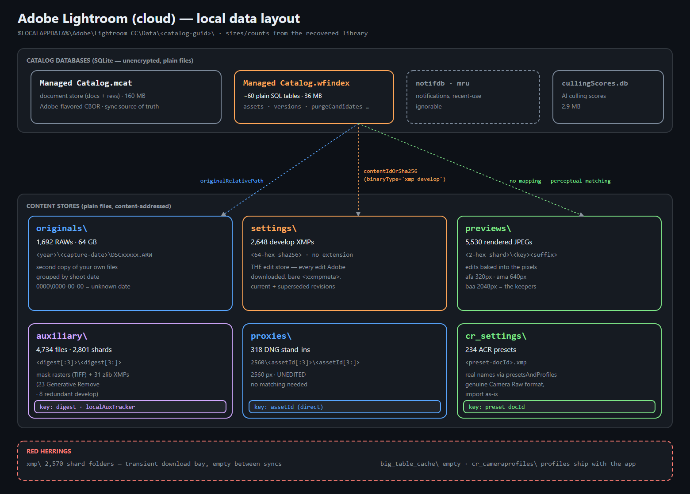

*(with sizes/counts from the recovered library · vector:
[lightroom-cc-layout.svg](assets/lightroom-cc-layout.svg))*

Library-agnostic version — same structure, no sizes or counts:

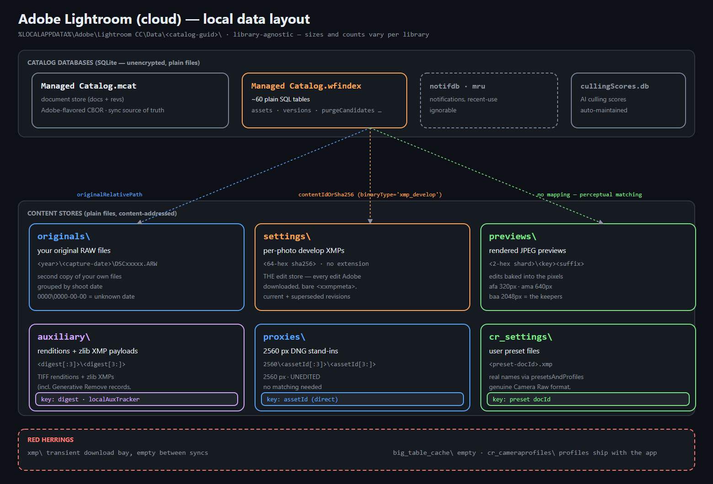

*(vector: [lightroom-cc-layout-plain.svg](assets/lightroom-cc-layout-plain.svg))*

Both regenerate with `scripts/make_layout_diagram.py`. Monospace tree
versions: [detailed with counts](assets/lightroom-cc-data-tree.png) ·
[simplified, no counts](assets/lightroom-cc-data-tree-plain.png) —
and the exact text tree below.

Everything lives under one folder — unencrypted, plain files + SQLite:

```mermaid
flowchart TB
    subgraph ROOT["%LOCALAPPDATA% / Adobe / Lightroom CC / Data / &lt;guid&gt;"]
        subgraph DB["SQLite catalogs"]
            MCAT["Managed Catalog.mcat<br/>document store: docs + revs<br/>content = Adobe-flavored CBOR"]
            WFX["Managed Catalog.wfindex<br/>~60 plain tables — the goldmine<br/>(assets, versions, paths, purge index)"]
            NDB["Managed Catalog.notifdb<br/>notifications (ignorable)"]
        end
        subgraph STORES["content-addressed file stores"]
            ORIG["originals / year / date / *.ARW<br/>1,692 full-resolution RAWs (64 GB)<br/>second copy of files you already own"]
            SET["settings / &lt;sha256&gt;<br/>2,648 extensionless blobs<br/>★ per-photo develop XMPs"]
            PREV["previews / &lt;shard&gt; / &lt;key&gt;&lt;suffix&gt;<br/>5,530 JPEG renders, edits baked in<br/>suffix: afa=320px ama=640px baa=2048px"]
            AUX["auxiliary / &lt;digest[:3]&gt; / &lt;digest[3:]&gt;<br/>4,734 mixed: TIFF renditions (02)<br/>+ zlib XMP payloads (uint32 len + 78 9c)"]
            PROX["proxies / 2560 / &lt;aid[:3]&gt; / &lt;aid[3:]&gt;<br/>318 lossy DNG stand-ins<br/>(NOT edited)"]
            CRS["cr_settings / &lt;docId&gt;.xmp<br/>234 user presets"]
            CDEF["cr_defaults, cr_cameraprofiles<br/>raw defaults / camera profiles"]
            EMPTY["xmp, big_table_cache<br/>empty on this machine"]
        end
    end
    DB ~~~ STORES
```

Naming scheme shared by `auxiliary\` and `proxies\`: a 32-hex id is sharded
as `<id[:3]>\<id[3:]>` — the first three characters name the folder, the
rest name the file.

---

## 2. Catalog tables and file stores — the join graph

The core data structure: `wfindex` tables (plain SQL) linked to each other
by three overlapping key-spaces, and to the physical files by digests and
sha256s. Bold row names are the ones that matter most.

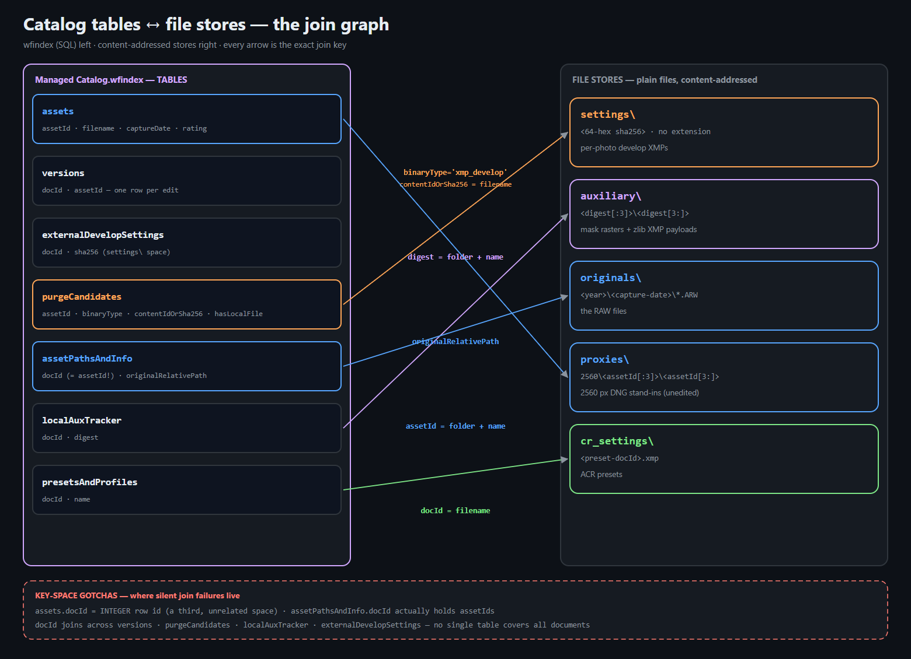

*(vector: [join-graph.svg](assets/join-graph.svg) — regenerate with
`scripts/make_join_graph_image.py`; the interactive Mermaid version below
adds the table-to-table relations)*

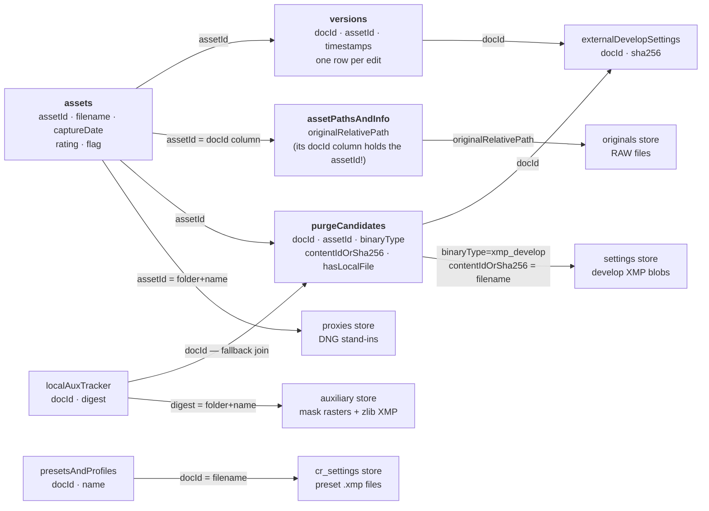

Key-space gotchas (all three bite during joins):

| Column | What it actually contains |
|---|---|
| `assets.docId` | INTEGER row id — a *different* space from the hex docIds |
| `assetPathsAndInfo.docId` | the **assetId** (32-hex), not the assets row id |
| `versions.docId`, `purgeCandidates.docId`, `localAuxTracker.docId` | hex docIds — but no single table covers all documents, hence the fallback joins |

`purgeCandidates.binaryType` census — the map of what exists where:

| binaryType | meaning | example count | local |
|---|---|---|---|
| `original` | the RAW file | 1,998 | 1,646 |
| `xmp_develop` | full develop settings | 3,457 | **2,123** |
| `aux` | mask rasters (the .acr payload) + zlib XMPs (gen-remove, redundant develop) | 5,403 | 4,676 |
| `proxy` | DNG stand-in | 1,998 | 310 |

(`hasLocalFile` is Adobe's own flag for "the blob is on this machine";
`ozHasBinary=1` means Adobe's cloud still has it.)

### 2.1 The `settings\` join in detail — wfindex → named sidecars

The whole mapping rests on one co-occurrence: every
`purgeCandidates` row with `binaryType='xmp_develop'` carries **both** the
photo's `assetId` **and** the `contentIdOrSha256` — and that sha256 *is the
file name* inside `settings\`. No decoding, no hashing, no parsing: one SQL
row is the entire link.

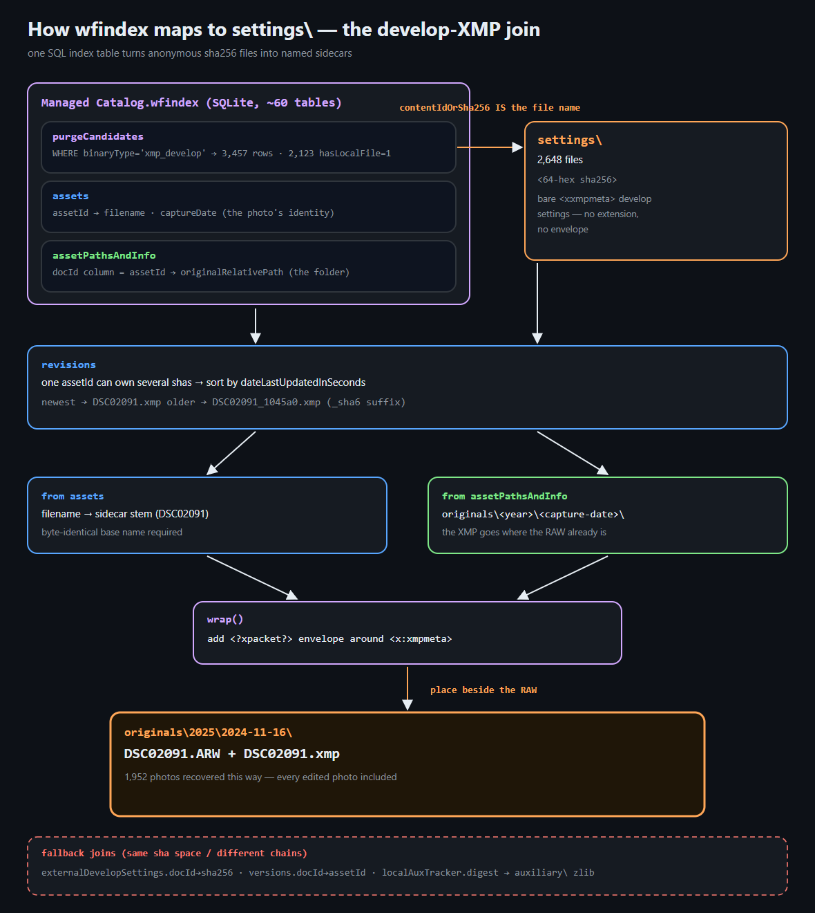

*(with counts from the recovered library · vector:
[wfindex-settings-join.svg](assets/wfindex-settings-join.svg) —
regenerate with `scripts/make_settings_flow_image.py`)*

Library-agnostic version (no counts):

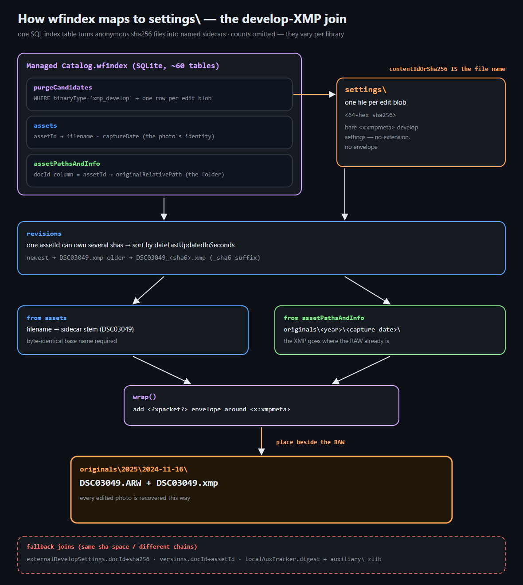

*(vector: [wfindex-settings-join-plain.svg](assets/wfindex-settings-join-plain.svg))*

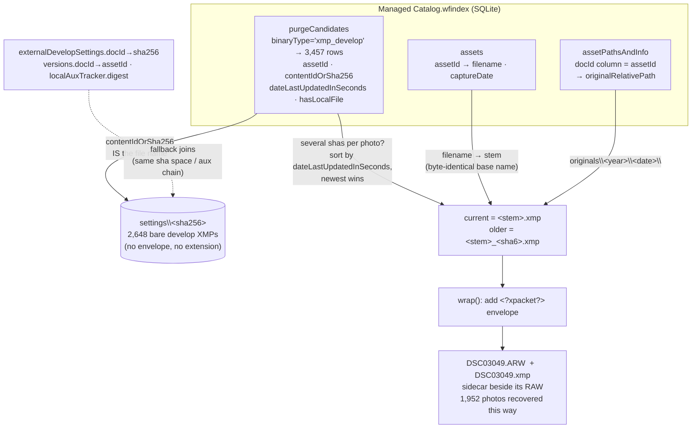

Why the fallbacks exist: `purgeCandidates` is cache bookkeeping, so Adobe
prunes it — some on-disk shas have no row left (they landed in
`_unlinked\`), and some XMPs travel through the `auxiliary\` zlib chain
instead. The other tables are redundant key-spaces covering those gaps.

### 2.2 wfindex internal structure — 62 tables at a glance

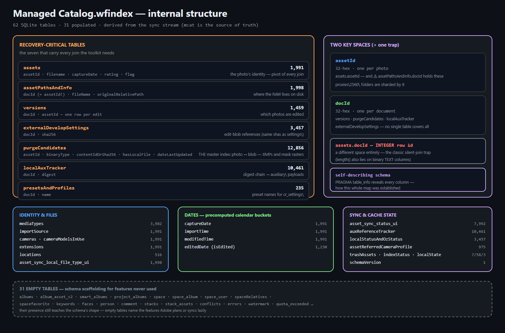

*(with row counts from the recovered library · vector:
[wfindex-structure.svg](assets/wfindex-structure.svg) — regenerate with
`scripts/make_wfindex_diagram.py`)*

Simplified overview (the 7 tables + key spaces only):

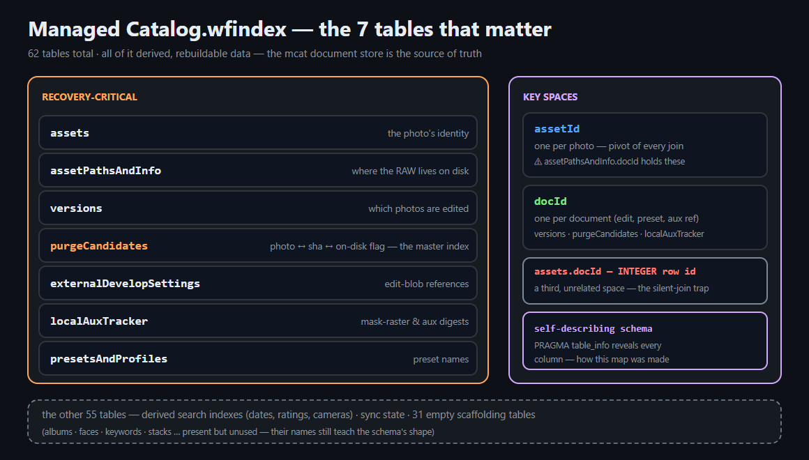

*(vector: [wfindex-structure-plain.svg](assets/wfindex-structure-plain.svg))*

Same map as Mermaid (renders natively on GitHub):

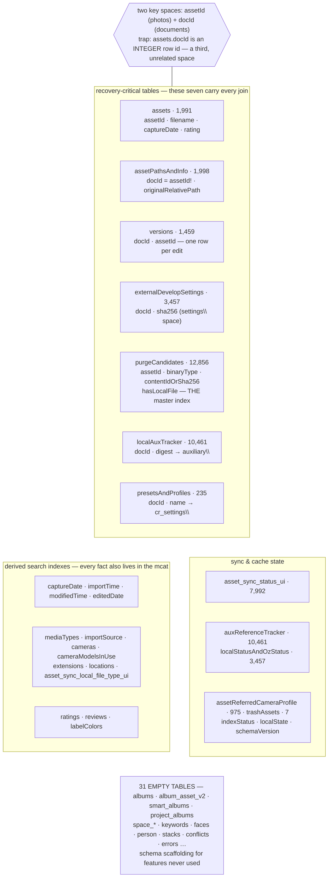

Seven tables do all the recovery work; everything else is derived search
indexing (`captureDate`, `ratings`, …), sync state, or empty scaffolding
for features never used (albums, faces, keywords — 31 empty tables whose
names still teach the schema's shape). Two key-spaces interlock the whole
database — `assetId` (photos) and `docId` (documents) — plus the one trap
that costs everyone an hour: `assets.docId` is an INTEGER row id in a
*third*, unrelated space.

About the name: `.wfindex` most likely stands for *window-function index* — Adobe does not say; treat it as a SQLite projection either way.

Remember the hierarchy: **wfindex is derived data.** The `mcat` document
store is the sync source of truth; Adobe's own troubleshooting pages tell
users to delete the local catalog and let Lightroom rebuild it — which is
also why the toolkit snapshots these files before anything else.

### 2.3 How the linkage was discovered — the forensic path

The mechanism above (§2.1) reads clean in hindsight; this is what finding
it actually looked like — dead ends and the wrong conclusion included:

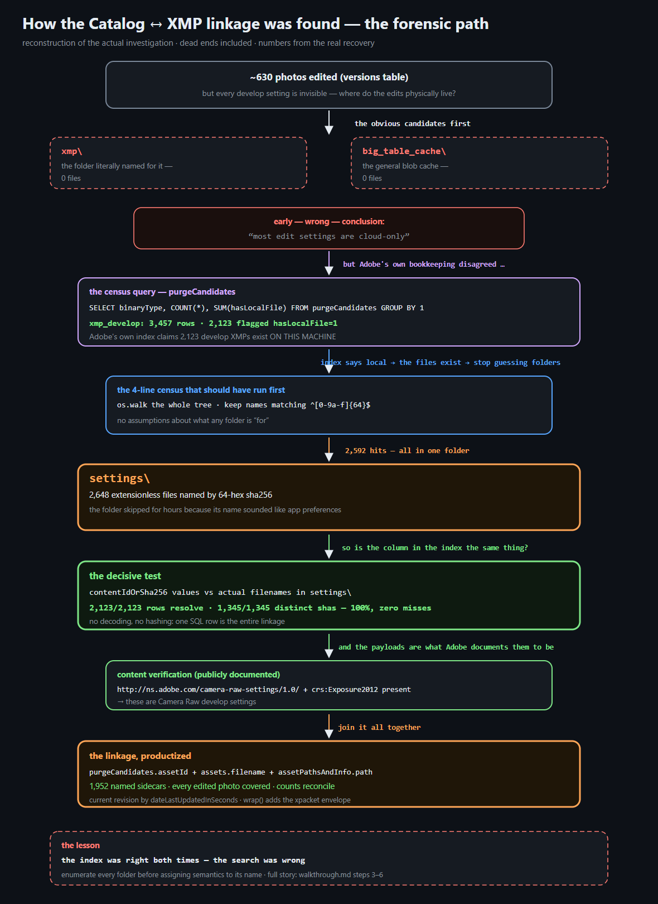

*(vector: [catalog-xmp-discovery.svg](assets/catalog-xmp-discovery.svg) —
regenerate with `scripts/make_discovery_flow_image.py`; mirrors
[walkthrough.md](walkthrough.md) steps 3–6)*

The short version: the obvious folders were empty, so the working theory
became "edits are cloud-only" — until one census query showed Adobe's own
index claiming 2,123 develop XMPs were on the machine. Trusting the index
over intuition led to a full filename census, which exposed `settings\`
(sitting there the whole time, misjudged by its name), and one comparison
— index column vs filenames — settled the linkage: **every indexed sha
matched (2,123/2,123 rows · 1,345/1,345 distinct — 100%, zero misses).**

---

## 3. How one photo's edit becomes a sidecar

The resolution chain the toolkit walks for every edited photo:

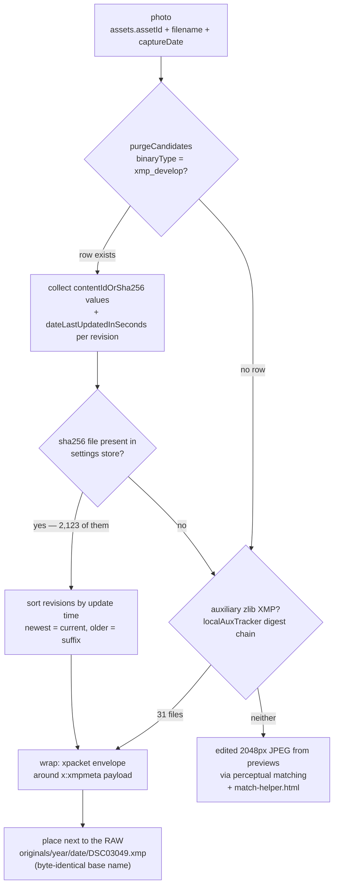

The failure mode to remember: Camera Raw silently ignores any sidecar
whose base name is not byte-identical to the photo's — no error, no
warning. That rule drives the whole naming strategy.

---

## 4. The recovery pipeline

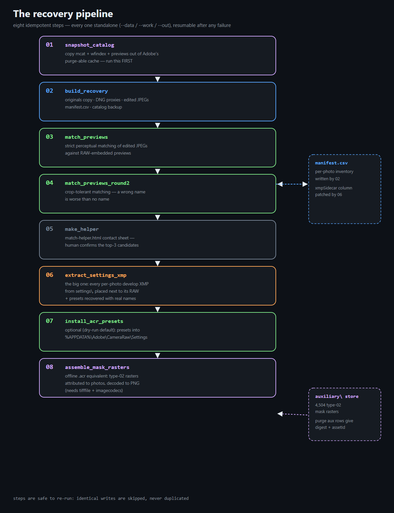

*(vector: [pipeline.svg](assets/pipeline.svg) — regenerate with
`scripts/make_pipeline_image.py`; the interactive Mermaid version below)*

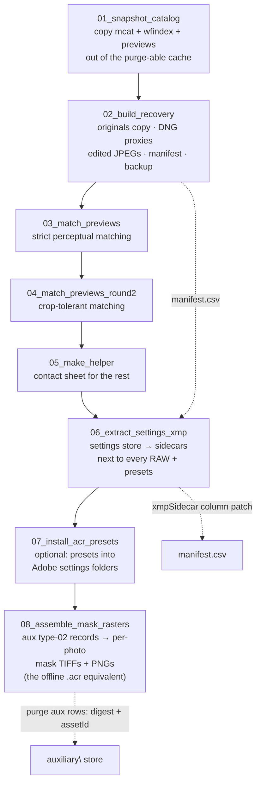

Each step is idempotent and standalone (`--data / --work / --out`), so the
pipeline can be resumed from any step after a failure. Step 08 exists for
the fully-offline path: a working Lightroom export delivers real `.acr`
companions from the cloud (§6.8), but a locked-out user has only the local
`auxiliary\` rasters — which this step attributes and decodes.

---

## 5. ACR files vs aux payloads — what is importable

"ACR file" and "XMP file" are the same thing here — Adobe's own Lightroom
Classic documentation calls these sidecars "XMP/ACR files"
([Create XMP/ACR files in Lightroom Classic](https://helpx.adobe.com/tw/lightroom-classic/desktop/organize-photos-in-lightroom-classic/create-xmp-acr-files.html)).
What Adobe stores per photo **is** the Camera Raw (ACR) develop
representation. Nothing needs converting — the recovered sidecars import
as-is:

| Artifact | Format | Importable? | Where |
|---|---|---|---|
| `settings\`-derived sidecars | crs XMP, masks embedded inline (`MaskGroupBasedCorrections` verified in 120/120 sampled) | ✅ sidecar for ACR / Bridge / Classic | `originals\<year>\<date>\<RAW-name>.xmp` |
| `_unlinked\` orphans | same complete ACR XMP format, photo link lost from the index | ✅ but must be renamed manually to the photo's base name | `xmp-sidecars\_unlinked\` |
| `cr_settings\` presets | ACR preset schema (`crs:PresetType`, `crs:Cluster`) | ✅ copy into the settings folder — `07_install_acr_presets.py` automates it | `presets\` |
| mask rasters (aux type-02) | JPEG-XL tiled TIFFs (`JPEGXL_DNG`, tag 52546) — the payload inside `.acr` | ✅ recovered offline by `08_assemble_mask_rasters.py` (viewable PNGs); Adobe apps get the real `.acr` only via cloud export | `mask-rasters\` |
| `_aux` XMPs | `crs:RequestInfo/ResponseInfo` records of Adobe's Generative Remove service | ❌ the AI pixels live on Adobe's servers; these are provenance, not settings | alongside their photos |

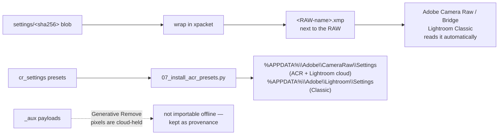

**The `.acr` cannot be obtained offline — only synthesized.** The cache
stores the *payload* (type-02 rasters in `auxiliary\`); the container is
manufactured at export time and exists only in a cloud export. Step 08
re-assembles the payload per photo (functional equivalent); the byte-exact
`.acr` comes only from a working Lightroom "original + settings" export.
Note also: `aux` zlib XMPs are 23 Generative Remove records *plus 8
develop XMPs redundant with `settings\`* — the duplicate path that
briefly misled the hunt.

Settings-folder locations per Adobe's documentation:
ACR and Lightroom share `%APPDATA%\Adobe\CameraRaw\Settings`; Lightroom
Classic uses `%APPDATA%\Adobe\Lightroom\Settings`. The `.acr` mask
raster story — export container vs offline recovery — has its own
diagram in [§6.8](#68-the-acr-export-companion--mask-rasters-packaged).

---

## 6. File-format anatomy — ARW, DNG, XMP, and the aux container

Every image format in this recovery except XMP is **TIFF underneath**. Where
a PNG is a linear stream of `[4-byte length][4-byte type][data][4-byte CRC]`
chunks, a TIFF file is a chain of **IFDs** (image file directories): each IFD
is a table of 12-byte entries
`[2-byte tag][2-byte type][4-byte count][4-byte value-or-offset]`, closing
with a link to the next IFD. A "chunk" in TIFF-land is just an IFD entry
pointing at data anywhere else in the file.

| Concept | PNG | TIFF (ARW / DNG) | XMP |
|---|---|---|---|
| unit | chunk `[len][type][data][crc]` | IFD entry `[tag][type][count][value/offset]` | XML element |
| addressing | sequential stream | offset-linked chains (IFD → SubIFD → ExifIFD → MakerNotes) | tree (RDF graph) |
| magic | `89 50 4E 47` | `49 49 2A 00` (LE) / `4D 4D 00 2A` (BE) | `<?xpacket` / `<x:xmpmeta` |

### 6.1 ARW — a TIFF with the sensor data in a SubIFD

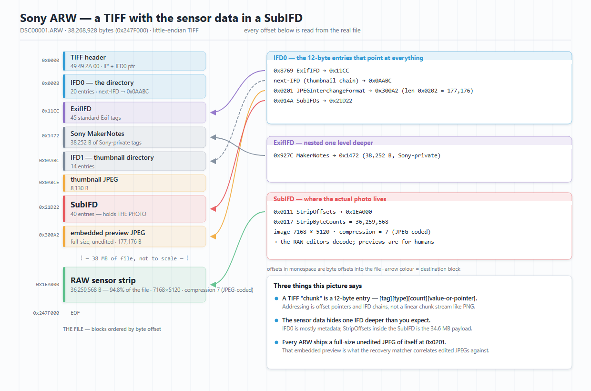

*(vector source: `assets/arw-structure.svg` · regenerate with
`python docs/assets/make_arw_diagram.py <file.ARW>`, which reads every offset
from the file and writes both the SVG and the PNG)*

The diagram's offsets are real, parsed from `DSC03049.ARW` (45.6 MB):

```
00000000  49 49 2a 00 08 00 00 00 13 00 fe 00 04 00 01 00  II*.............
          ^magic      ^IFD0@8     ^19 entries ^tag 0x00FE (NewSubfileType)
00000010  00 00 01 00 00 00 03 01 03 00 01 00 00 00 06 00  ................
```

- `II*\0` — little-endian TIFF, IFD0 at offset 8 with 19 entries
- IFD0 entry `0x8769` → ExifIFD at `0x11c0` (which nests Sony's MakerNotes
  `0x927C` at `0x1466`, 38,252 B); entry `0x014A` → **SubIFDs** at `0x21d22` —
  Sony keeps the actual raw sensor strip (7168×5120, 41.6 MB at `0x3d0000`) in
  a SubIFD, not in IFD0
- entry `0x0201` (JPEGInterchangeFormat) → `0x300a2`: a 245 KB **preview**, not
  the frame. The **full-size** 7008×4672 JPEG (3.6 MB at `0x6c000`) hangs off
  **IFD2**, reached through IFD1's next-IFD pointer. 144 `FFD8FF` starts in
  total; the matcher keeps the largest `FFD8FF…FFD9` span, which is IFD2's frame

The embedded preview is the load-bearing fact for recovery: every ARW carries
its own visual record of the *unedited* photo inside it, which is what
`03/04_match_previews.py` correlate the edited JPEGs against — no metadata
required.

### 6.2 ARW vs the other brands — same skeleton, different sins

Nearly every RAW is a TIFF/EP dialect: same `II*\0`, same IFD machinery, with
the differences hiding in *where* the sensor strip sits, which codec squashed
it, and how much the MakerNotes fight back. The exceptions are the fun part —
Canon's current format is the one that actually behaves like PNG chunks.

| Brand | Ext | Container | Sensor data & compression | Notable quirk |
|---|---|---|---|---|
| Sony | `.ARW` | TIFF/EP | SubIFD strip; lossy 11-bit block-delta, lossless (newer bodies), or uncompressed | ARW 2.3's off-by-one data offset — every decoder carries the `+1 byte` hack |
| Canon (retired) | `.CR2` | TIFF/EP | lossless old-style JPEG in a Canon SubIFD | |
| Canon (current) | `.CR3` | **ISO BMFF** — MP4-style boxes (`ftyp`/`moov`/`mdat`) | proprietary prediction+quantization codec; lossy & full modes, HDR-PQ | the only mainstream RAW built from `[size][type]` chunk boxes — Canon moved *away* from pointer-based TIFF |
| Nikon | `.NEF`/`.NRW` | TIFF/EP | lossless or quantized old-style JPEG; Z-series High Efficiency codec | historically encrypted MakerNote white balance (key from serial no. — the 2005 Adobe-vs-Nikon spat) |
| Fujifilm | `.RAF` | **not TIFF** — `FUJIFILMCCD-RAW` header + section offset table | lossless coding, sections not IFDs | X-Trans 6×6 colour array (not Bayer); several embedded JPEGs |
| Olympus/OM | `.ORF` | TIFF/EP | old-style JPEG lossless | legacy files used `MMOR`/`IIRO` magic instead of `II*`/`MM*` |
| Panasonic | `.RW2`/`.RWL` | TIFF-*like* | mostly uncompressed | magic is `IIU\0` with rearranged IFD semantics |
| Pentax/Ricoh | `.PEF` | plain TIFF/EP | old-style JPEG lossless | also offers native DNG |
| Leica / Apple / DJI | `.DNG` | TIFF (Adobe spec) | any DNG-sanctioned codec | Apple ProRAW is a *linear* DNG — already demosaiced RGB |
| Sigma | `.X3F` | custom container | Foveon 3-layer capture | not a colour-filter array at all |
| Phase One | `.IIQ` | TIFF-ish | lossless | "secure" variants ship encrypted |

Three observations that matter more than the table:

1. **Codec genealogy** — the shared ancestor is *old-style JPEG lossless*
   (predictive JPEG without quantization), which most brands still use for
   their lossless modes. The modern replacements are all brand codecs:
   Sony's lossy 11-bit block-delta, Nikon's High Efficiency, Canon's
   CRX predictor + quantization inside BMFF.
2. **"One level deeper than you expect" is industry-wide** — Sony hides the
   strip in a SubIFD, Canon in `mdat` boxes, Fuji in numbered sections.
   Partly architecture, partly accident, partly gentle obfuscation.
3. **What never changes** (and why this recovery generalizes): every RAW
   embeds JPEG previews of itself (the perceptual matcher works on any
   brand); sync treats a RAW as opaque bytes (Adobe never parses it); and
   edits always ride *separately* as XMP — the one exception being DNG,
   which can also carry the XMP *inside* the file.

### 6.3 DNG — the same TIFF, publicly specified

DNG is Adobe's open RAW container: a TIFF plus mandated tags. The
`proxies\2560\` files are ordinary small DNGs — `II*\0`, 64 IFD0 entries,
verified tags `0xC612 DNGVersion = 04 00 00 00`, `0xC614
UniqueCameraModel`, and `ImageWidth×Length = 2560×1707` (hence the folder
name). Key difference from a rendered preview: these are **unedited**
stand-ins, keyed directly by assetId — no matching needed, pure rename.

### 6.4 XMP — not chunks at all, RDF/XML

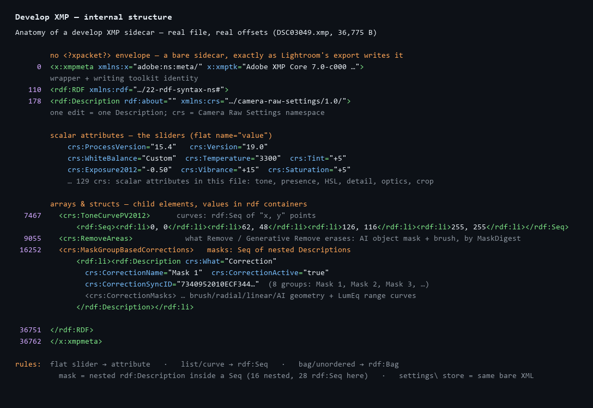

*(vector source: `assets/xmp-structure.svg` · regenerate with
`scripts/make_xmp_structure_image.py <file.xmp>` — every offset and value above
is measured from `DSC03049.xmp`, 36,775 bytes: 129 `crs:` scalar attributes,
28 `rdf:Seq` arrays, 16 nested Descriptions in 8 mask groups and a Generative
Remove)*

One edit is one flat bag of `crs:*` attributes in a namespaced XML tree —
there is no binary container to parse. The full skeleton, with the real
byte offsets from that file:

```
     0   <x:xmpmeta x:xmptk="Adobe XMP Core 7.0-c000 …">          ← wrapper + toolkit identity
                                                                    (no <?xpacket?>: a bare export sidecar)
   110     <rdf:RDF>                                              ← RDF graph root
   178       <rdf:Description rdf:about="" xmlns:crs="…/camera-raw-settings/1.0/">
               │
               ├─ scalars: flat attributes — the sliders
               │    crs:ProcessVersion="15.4"  crs:WhiteBalance="Custom"
               │    crs:Temperature="3300"  crs:Tint="+5"  crs:Vibrance="+15"
               │    crs:Exposure2012="-0.50"  crs:Saturation="+5"  … (129 here)
               │
               ├─ arrays: child elements, values in rdf containers
               │  7467   <crs:ToneCurvePV2012>            curves = Seq of "x, y" points
               │           <rdf:Seq><rdf:li>0, 0</rdf:li><rdf:li>62, 48</rdf:li>…<rdf:li>255, 255</rdf:li></rdf:Seq>
               │
               ├─ what Generative Remove erases
               │  9055   <crs:RemoveAreas>                AI object mask + brush, by MaskDigest
               │
               └─ structs: nested Descriptions inside a Seq
                 16252   <crs:MaskGroupBasedCorrections>   one li per mask group (8 here)
                           <rdf:li><rdf:Description crs:What="Correction"
                             crs:CorrectionName="Mask 1"  crs:CorrectionActive="true"
                             crs:CorrectionSyncID="7340952010ECF344…">
                             <crs:CorrectionMasks> … brush/radial/linear/AI geometry
                                                + LumEq range curves … </rdf:Description></rdf:li>
                         <crs:RangeMaskMapInfo> … </crs:RangeMaskMapInfo>
 36751   </rdf:RDF>
 36762   </x:xmpmeta>
```

Encoding rules the tree implies:

- **flat slider → attribute** on the Description; **list/curve → `rdf:Seq`**
  (ordered — curve points); **unordered set → `rdf:Bag`** (e.g. Looks);
  **alternative → `rdf:Alt`** (e.g. localized `dc:title`).
- **A mask is a full nested `rdf:Description`** — masks are edits-within-
  the-edit, each carrying its own name, sync id, geometry, and even its
  own curves (`LumEq`). That is why DSC03049's sidecar reaches 36 KB; across
  the 2,648 develop blobs in the cache the smallest is 4.9 KB and the
  largest 117 KB.
- **`crs:CorrectionSyncID`** is how Adobe links a mask across the sync
  ecosystem — the same id family the recovery chases in the catalog.

The `settings\` store keeps these **bare**: the blob on disk starts directly
with `<x:xmpmeta` and carries **no `<?xpacket?>` envelope** (verified — every
sampled blob). Lightroom's own "original + settings" export writes them bare
too: all 84 export sidecars checked, DSC03049.xmp included, start at
`<x:xmpmeta`. Step 06's `wrap()` still adds the envelope when it writes a
sidecar, for XMP readers outside Adobe that expect a packet.

### 6.5 The aux container — one box, three record types

Census of all 4,734 `auxiliary\` files by first bytes:

| first bytes | count | meaning |
|---|---|---|
| `02 00 00 00 01 00 00 00 …` | 4,504 | rendition records (rendered pixels, TIFF-ish) |
| `05 00 00 00 02 00 00 00` + 8-byte field | 198 | type-5 records (timestamp-like field) |
| `<uint32 LE> 78 9C …` | 31 | zlib-compressed XMP |

The zlib XMPs are **double-framed** — the length prefix counts the
*decompressed* size, and the inflated stream has its own 12-byte frame before
the payload:

```
on disk:   [uint32 LE: decompressed size] [zlib stream: 78 9C …]
inflated:  [01 00 01 00] [01 00 00 00] [uint32 LE: xmpmeta length] [<x:xmpmeta … </x:xmpmeta>]
```

### 6.6 Same edit, three envelopes — how the merge actually works

The identical `<x:xmpmeta>` payload travels in three wrappers, and the
recovery merge is pointer-chasing between them — the only content transform
is adding the envelope:


Rules that make the merge correct rather than just possible:

- **Join by key, not by content** — `purgeCandidates.contentIdOrSha256` *is*
  the filename inside `settings\`; no hashing or parsing needed to link.
- **Newest revision wins** — several shas can exist per photo; the highest
  `dateLastUpdatedInSeconds` becomes `<base>.xmp`, older ones keep a sha suffix.
- **Never touch the pixels** — the RAW file is never modified or re-encoded;
  XMP is non-destructive by design, so "merging" means *placing the parameter
  file next to the pixel file* and nothing more. The only pixel-level work in
  the whole recovery is *naming* preview JPEGs (§3, perceptual matching) —
  and that is read-only too.

### 6.7 The XMP directory map — source stores → recovery layout

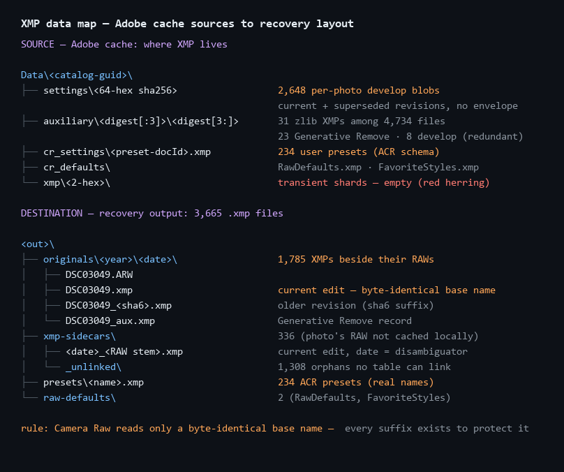

*(PNG above; vector version: [xmp-directory-map.svg](assets/xmp-directory-map.svg) — regenerate with `scripts/make_xmp_map_image.py`.)*

Every place XMP lives in Adobe's cache, and where the toolkit puts it.
Counts are from the real recovery.

**Source — XMP-bearing paths inside `Data\<guid>\`:**

```
Data\<guid>\
├── settings\<64-hex sha256>              2,648 per-photo develop blobs
│                                         (current + superseded revisions,
│                                          bare <x:xmpmeta>, no envelope)
├── auxiliary\<digest[:3]>\<digest[3:]>   31 zlib-compressed XMPs among 4,734 files:
│                                         23 Generative Remove records
│                                         + 8 develop settings (already covered by settings\)
├── cr_settings\<preset-docId>.xmp        234 user presets (ACR preset schema)
├── cr_defaults\                          RawDefaults.xmp · FavoriteStyles.xmp
└── xmp\<2-hex>\                          transient download shards — empty between syncs
```

**Destination — the recovery output (3,665 .xmp files total):**

```
<out>\
├── originals\<year>\<date>\                1,785 XMPs beside their RAWs
│   ├── DSC03049.ARW
│   ├── DSC03049.xmp                        1,639 current edits (byte-identical base name)
│   ├── DSC03049_<sha6>.xmp                 124 older revisions (sha6 suffix)
│   ├── DSC03049_<sha6>_1.xmp                 4 collision-renamed revisions (distinct content)
│   └── DSC03049_aux.xmp                     18 Generative Remove records
├── xmp-sidecars\                           336 XMPs for photos with no local RAW
│   ├── 2026-09-25_DSC03049.xmp             313 current edits (date prefix = disambiguator)
│   ├── 2026-09-25_DSC03049_<sha6>.xmp       22 orphan revisions
│   └── 2026-09-25_DSC03049_aux.xmp            1 Generative Remove record
├── xmp-sidecars\_unlinked\                 1,308 orphans no table can link
│   ├── <sha256>.xmp                        1,303 develop revisions
│   └── <digest>.xmp                            5 Generative Remove records
├── presets\<name>.xmp                        234 ACR presets (real names)
└── raw-defaults\                              2 (RawDefaults, FavoriteStyles)
```

**Naming grammar** — every suffix the pipeline can produce:

| Pattern | Meaning | Importable as-is? |
|---|---|---|
| `<RAW stem>.xmp` | current edit of that photo | ✅ (this is the required form) |
| `<RAW stem>_<sha6>.xmp` | older edit revision | ✅ after renaming (drop suffix) |
| `<RAW stem>_<sha6>_<n>.xmp` | revision whose sha6 prefix collided | ✅ after renaming |
| `<RAW stem>_aux.xmp` | Generative Remove record — provenance, not look | ❌ AI pixels are cloud-held |
| `<date>_<RAW stem>.xmp` | photo whose RAW was never cached locally | ✅ rename when the RAW is found |

The one rule underneath all of them: **Camera Raw only reads a sidecar whose
base name is byte-identical to the photo's** — every suffix above exists to
preserve information without breaking that rule for the *current* revision.

---

### 6.8 The `.acr` export companion — mask rasters, packaged

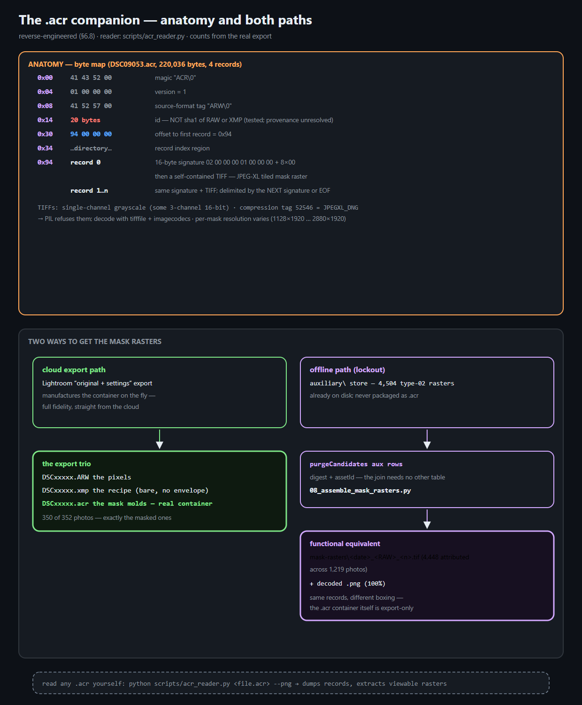

*(vector: [acr-flow.svg](assets/acr-flow.svg) — regenerate with
`scripts/make_acr_flow_image.py <file.acr>`; read any `.acr` with
`scripts/acr_reader.py <file> --png`)*

Byte-level anatomy, every offset real (`DSC03049.acr`; layout confirmed on 77 exported files):

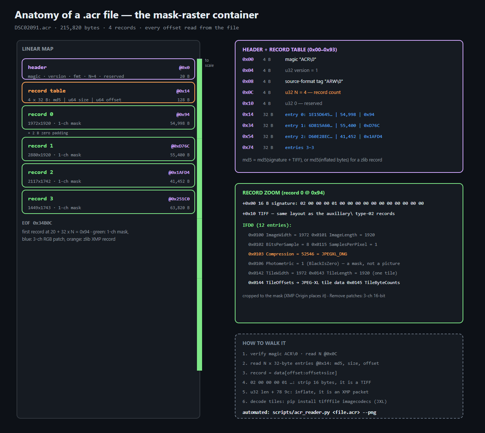

*(vector: [acr-structure.svg](assets/acr-structure.svg) — regenerate with
`scripts/make_acr_structure_image.py <file.acr>`)*

What a real `.acr` decomposes into — every record decoded, labelled from
the sibling XMP by md5, then placed back on the photo (`DSC03049.acr`: six
AI masks, the three Generative Remove candidates, their fill mask and a
zlib-packed receipt):

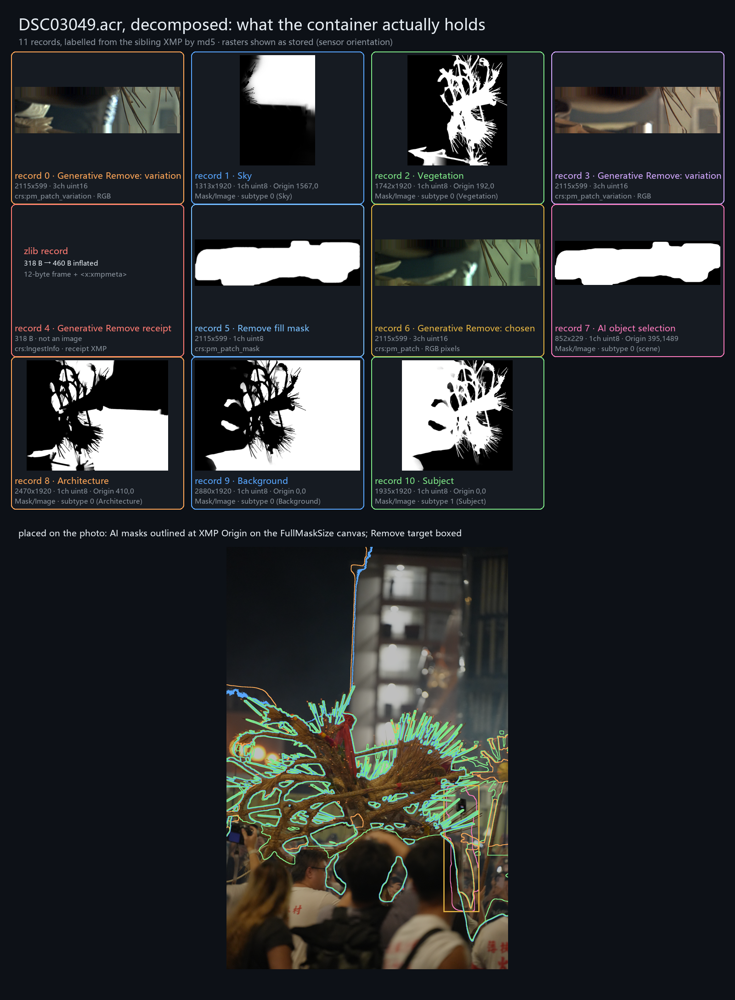

*(regenerate with `scripts/make_acr_decomposed_image.py <file.acr>`; add
`--no-photo` to skip the composite, which outlines each mask on the photo's
embedded JPEG at the XMP's `Origin`. Masks are stored in sensor orientation,
so the composite is built unrotated and turned for display at the end)*

A later real-world export ("original + settings") revealed a third
companion Adobe emits per photo: `<name>.acr`. It is written exactly when
the edit contains AI masks (`crs:What="Mask/Image"`): 350 of 352 photos in
the first export, and 84 of 84 sidecars checked in two later ones. Gradient,
radial, brush and range masks are pure parameters and never produce a
raster. Structure, verified on 77 real files (311 records):

```
0x00  "ACR\0"  u32 version=1  "ARW\0"  u32 N (record count)  u32 0 (reserved)
0x14  N × 32-byte entries, sorted by md5:  md5[16] | u64 size | u64 offset
20+32N  records, each 4-byte aligned (zero padding), two kinds:
        raster: 16-byte header 02 00 00 00 01 00 00 00 … (== auxiliary\ type-02!)
                + TIFF: tiled JPEG-XL; 1-channel 8-bit masks, 3-channel 16-bit patches
        zlib:   u32 inflated length + zlib stream → 12-byte frame + XMP packet
                (the Generative Remove receipt; its md5 is over the inflated bytes)
multiple records per file  ↔  multiple AI masks / Remove patches per photo
```

So `.acr` is Adobe Camera Raw's **mask-raster container**: the XMP carries
the parametric edit (sliders, geometry, LumEq curves), while the computed
mask *bitmaps* — the same rasters that live as type-02 records in the
local `auxiliary\` store — travel in this file. The binding is content
addressing: each table entry's md5 is the md5 of the record (signature +
TIFF), and that value appears in the XMP as `crs:MaskDigest` (AI masks) or
`crs:pm_patch` / `crs:pm_patch_variation` / `crs:pm_patch_mask` (Remove and
Generative Remove fills) or `crs:IngestInfo` (the Generative Remove
receipt). The local cache names the identical record by the same md5
(4,504/4,504), and 106 of the first 300 ACR records were found
byte-identical in the cache. The table is sorted by md5 (77 of 77 files),
not by XMP order, so readers must match by md5, not by position. Each
raster is cropped to its mask's bounding box; the XMP's `Origin` and
`FullMaskSize` place it on a canvas in sensor orientation, before any
`tiff:Orientation` rotation. (An earlier
version of this section described a "20-byte id" at 0x14 and a "directory
region": those were the first table entry's md5 + size, and the other
entries.) Keep `.acr` beside the ARW + XMP with the same base name: Adobe
apps re-assemble identical renders from the trio; third-party tools see
only the XMP.

Offline follow-up (step `08_assemble_mask_rasters.py`): the payload *is*
recoverable from the local cache — `purgeCandidates`' aux rows carry the
digest and the assetId directly. Of 4,504 type-02 rasters, 4,448 were
attributed across 1,219 photos (56 orphan digests) and 100% decoded to
viewable PNGs once the compression was identified as `JPEGXL_DNG`
(tag 52546 — needs `tifffile` + `imagecodecs`; PIL alone refuses the
file). The container itself is only made at export time, but with the
table decoded it can be rebuilt from cache records (whether Lightroom
accepts a rebuilt one is untested).

## 7. References

### Evidence base — what is documented vs what was established empirically

Adobe does **not** document the cloud Lightroom's local internals. This
project's claims split into two classes, and readers should know which is
which:

| Claim | Basis |
|---|---|
| XMP packet format, `crs:` namespace, sidecar naming, presets folders | **Adobe-documented** (links below) |
| The local sync database exists — `Managed Catalog.mcat` + `.wfindex` — and is safe to delete | **Adobe-documented**: [local sync database](https://helpx.adobe.com/hk_zh/lightroom-classic/desktop/kb/local-sync-database.html) (written for Classic's cloud sync, same component) + corrupted-catalog troubleshooting pages |
| `wfindex`'s ~60-table schema, `purgeCandidates` semantics (`binaryType`, `contentIdOrSha256`, `hasLocalFile`) | **Empirical** — SQLite schemas are self-describing (`PRAGMA table_info`); semantics verified by falsifiable tests |
| `settings\` files are the per-photo develop XMPs, sha-addressed | **Empirical** — every indexed sha matches a filename (2,123/2,123 rows · 1,345/1,345 distinct); census: 2,648/2,648 files begin `<x:xmpmeta`, declare the documented `crs:` namespace, and carry develop sliders (`Exposure2012`); 2,592/2,648 filenames are *literally* sha256 of the file bytes (56 rewritten in place keep their birth hash) |
| Join outputs are correct | **Empirical** — end-to-end checks: named sidecars contain the right sliders/masks for the right photos; counts reconcile (3,457 indexed · 2,648 on disk · 1,952 joined · all 621 edited covered) |

No public third-party documentation of these internals exists as of this
writing (the only outside mention of `wfindex` found is a diagnostic-log
excerpt). The verification snippets live in
[walkthrough.md](walkthrough.md) steps 5–6 — re-run them against any
library to reproduce the finding. Treat everything not in Adobe's docs as
reverse-engineered knowledge: accurate for the versions tested, subject to
change by Adobe without notice.

### External references

- Adobe: **The local sync database** (Lightroom Classic cloud sync) — the closest thing to official documentation of `Managed Catalog.mcat` / `.wfindex` —
  <https://helpx.adobe.com/hk_zh/lightroom-classic/desktop/kb/local-sync-database.html>
- FileInfo: the `.mcat` extension entry (community file-format database) —
  <https://fileinfo.com/zh/extension/mcat>

- Adobe: **Create XMP/ACR files in Lightroom Classic** — the definitive
  Adobe reference for what "ACR files" are (XMP sidecars written by
  Lightroom, read by Camera Raw) —
  <https://helpx.adobe.com/tw/lightroom-classic/desktop/organize-photos-in-lightroom-classic/create-xmp-acr-files.html>
- Adobe XMP specification and the Camera Raw settings namespace —
  <https://developer.adobe.com/xmp/docs/> · namespace
  `http://ns.adobe.com/camera-raw-settings/1.0/`
- Adobe: XMP metadata / "Save metadata to files" (how sidecars work) —
  <https://helpx.adobe.com/lightroom-classic/help/metadata-basics-actions.html>
- Adobe: Camera Raw presets and the settings folder location —
  <https://helpx.adobe.com/camera-raw/using/presets.html>
- Adobe: what happens when a Creative Cloud membership ends —
  <https://helpx.adobe.com/creative-cloud/help/creative-cloud-membership-basics.html>
- RFC 8949 — Concise Binary Object Representation (CBOR), the family the
  catalog's document blobs belong to —
  <https://www.rfc-editor.org/rfc/rfc8949>
- Couchbase Lite — the mobile database whose docs + revisions storage model
  the Managed Catalog mirrors —
  <https://docs.couchbase.com/couchbase-lite/current/introduction.html>
- The Lightroom Queen: what XMP data is and how Lightroom uses it —
  <https://www.lightroomqueen.com/what-is-xmp-data/>
- TIFF 6.0 specification — the IFD/tag structure ARW and DNG both build on —
  <https://download.osgeo.org/libtiff/doc/TIFF6.pdf>
- Adobe: Digital Negative (DNG) specification — the openly documented
  TIFF-based RAW container, incl. the `C612 DNGVersion` tag —
  <https://helpx.adobe.com/camera-raw/digital-negative.html>
