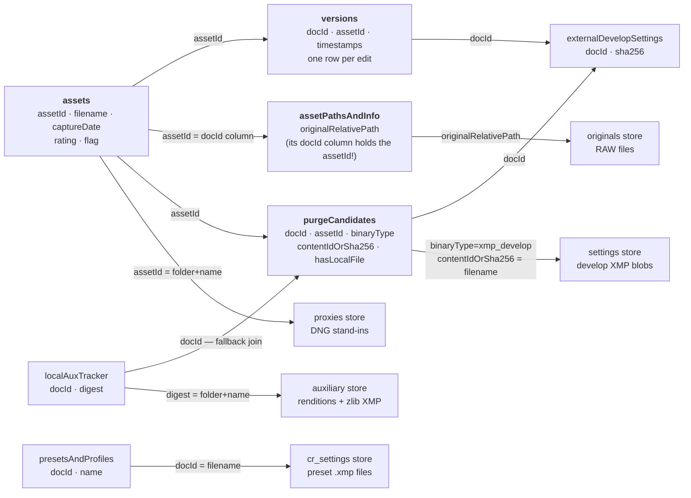
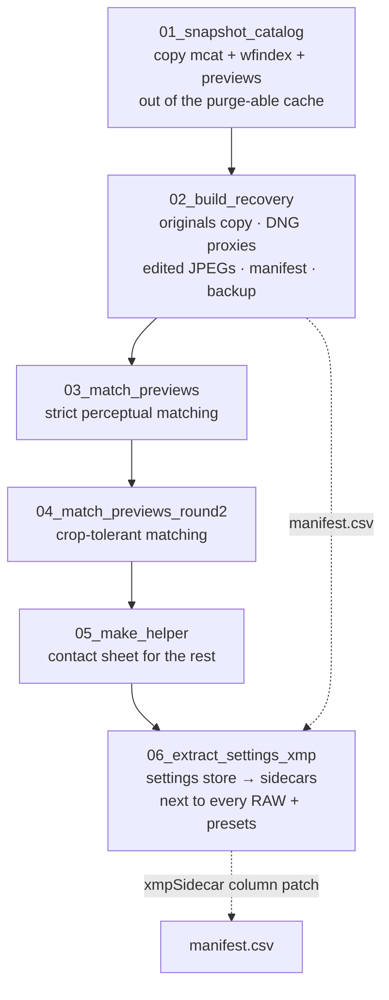
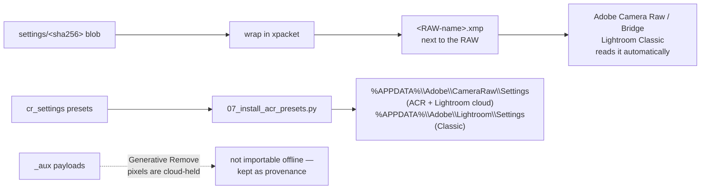
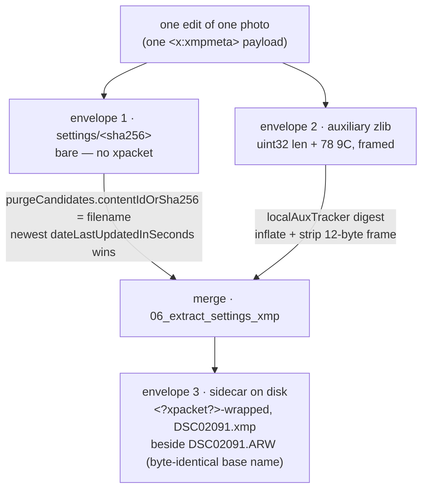

# Data structure diagrams

Mermaid diagrams — GitHub renders them natively. They map how Adobe
Lightroom (cloud) organizes its local data and how the toolkit joins the
pieces back into photos, edits, and presets.

- [1. Local storage layout](#1-local-storage-layout)
- [2. Catalog tables and file stores — the join graph](#2-catalog-tables-and-file-stores--the-join-graph)
- [3. How one photo's edit becomes a sidecar](#3-how-one-photos-edit-becomes-a-sidecar)
- [4. The recovery pipeline](#4-the-recovery-pipeline)
- [5. ACR files vs aux payloads — what is importable](#5-acr-files-vs-aux-payloads--what-is-importable)
- [6. File-format anatomy — ARW, DNG, XMP, and the aux container](#6-file-format-anatomy--arw-dng-xmp-and-the-aux-container)
- [7. References](#7-references)

---

## 1. Local storage layout

Everything lives under one folder — unencrypted, plain files + SQLite:

```mermaid
flowchart TB
    subgraph ROOT["%LOCALAPPDATA% / Adobe / Lightroom CC / Data / &lt;guid&gt;"]
        subgraph DB["SQLite catalogs"]
            MCAT["Managed Catalog.mcat<br/>document store: docs + revs<br/>content = Adobe-flavored CBOR"]
            WFX["Managed Catalog.wfindex<br/>~60 plain tables — the goldmine<br/>(assets, versions, paths, purge index)"]
            NDB["Managed Catalog.notifdb<br/>notifications (ignorable)"]
        end
        subgraph STORES["content-addressed file stores"]
            ORIG["originals / year / date / *.ARW<br/>1,692 full-resolution RAWs (64 GB)<br/>★★★ the photos"]
            SET["settings / &lt;sha256&gt;<br/>2,648 extensionless blobs<br/>★ per-photo develop XMPs"]
            PREV["previews / &lt;shard&gt; / &lt;key&gt;&lt;suffix&gt;<br/>5,530 JPEG renders, edits baked in<br/>suffix: afa=320px ama=640px baa=2048px"]
            AUX["auxiliary / &lt;digest[:3]&gt; / &lt;digest[3:]&gt;<br/>4,734 mixed: TIFF renditions (02)<br/>+ zlib XMP payloads (uint32 len + 78 9c)"]
            PROX["proxies / 2560 / &lt;aid[:3]&gt; / &lt;aid[3:]&gt;<br/>318 lossy DNG stand-ins<br/>(NOT edited)"]
            CRS["cr_settings / &lt;docId&gt;.xmp<br/>234 user presets"]
            CDEF["cr_defaults, cr_cameraprofiles<br/>raw defaults / camera profiles"]
            EMPTY["xmp, big_table_cache<br/>empty on this machine"]
        end
    end
    DB ~~~ STORES
```



Naming scheme shared by `auxiliary\` and `proxies\`: a 32-hex id is sharded
as `<id[:3]>\<id[3:]>` — the first three characters name the folder, the
rest name the file.

---

## 2. Catalog tables and file stores — the join graph

The core data structure: `wfindex` tables (plain SQL) linked to each other
by three overlapping key-spaces, and to the physical files by digests and
sha256s. Bold row names are the ones that matter most.



Key-space gotchas (all three bite during joins):

| Column | What it actually contains |
|---|---|
| `assets.docId` | INTEGER row id — a *different* space from the hex docIds |
| `assetPathsAndInfo.docId` | the **assetId** (32-hex), not the assets row id |
| `versions.docId`, `purgeCandidates.docId`, `localAuxTracker.docId` | hex docIds — but no single table covers all documents, hence the fallback joins |

`purgeCandidates.binaryType` census — the map of what exists where:

| binaryType | meaning | example count | local |
|---|---|---|---|
| `original` | the RAW file | 1,998 | 1,646 |
| `xmp_develop` | full develop settings | 3,457 | **2,123** |
| `aux` | auxiliary renditions | 5,403 | 4,676 |
| `proxy` | DNG stand-in | 1,998 | 310 |

(`hasLocalFile` is Adobe's own flag for "the blob is on this machine";
`ozHasBinary=1` means Adobe's cloud still has it.)

---

## 3. How one photo's edit becomes a sidecar

The resolution chain the toolkit walks for every edited photo:


The failure mode to remember: Camera Raw silently ignores any sidecar
whose base name is not byte-identical to the photo's — no error, no
warning. That rule drives the whole naming strategy.

---

## 4. The recovery pipeline



Each step is idempotent and standalone (`--data / --work / --out`), so the
pipeline can be resumed from any step after a failure.

---

## 5. ACR files vs aux payloads — what is importable

"ACR file" and "XMP file" are the same thing here — Adobe's own Lightroom
Classic documentation calls these sidecars "XMP/ACR files"
([Create XMP/ACR files in Lightroom Classic](https://helpx.adobe.com/tw/lightroom-classic/desktop/organize-photos-in-lightroom-classic/create-xmp-acr-files.html)).
What Adobe stores per photo **is** the Camera Raw (ACR) develop
representation. Nothing needs converting — the recovered sidecars import
as-is:

| Artifact | Format | Importable? | Where |
|---|---|---|---|
| `settings\`-derived sidecars | crs XMP, masks embedded inline (`MaskGroupBasedCorrections` verified in 120/120 sampled) | ✅ sidecar for ACR / Bridge / Classic | `originals\<year>\<date>\<RAW-name>.xmp` |
| `_unlinked\` orphans | same complete ACR XMP format, photo link lost from the index | ✅ but must be renamed manually to the photo's base name | `xmp-sidecars\_unlinked\` |
| `cr_settings\` presets | ACR preset schema (`crs:PresetType`, `crs:Cluster`) | ✅ copy into the settings folder — `07_install_acr_presets.py` automates it | `presets\` |
| `_aux` XMPs | `crs:RequestInfo/ResponseInfo` records of Adobe's Generative Remove service | ❌ the AI pixels live on Adobe's servers; these are provenance, not settings | alongside their photos |



Settings-folder locations per Adobe's documentation:
ACR and Lightroom share `%APPDATA%\Adobe\CameraRaw\Settings`; Lightroom
Classic uses `%APPDATA%\Adobe\Lightroom\Settings`.

---

## 6. File-format anatomy — ARW, DNG, XMP, and the aux container

Every image format in this recovery except XMP is **TIFF underneath**. Where
a PNG is a linear stream of `[4-byte length][4-byte type][data][4-byte CRC]`
chunks, a TIFF file is a chain of **IFDs** (image file directories): each IFD
is a table of 12-byte entries
`[2-byte tag][2-byte type][4-byte count][4-byte value-or-offset]`, closing
with a link to the next IFD. A "chunk" in TIFF-land is just an IFD entry
pointing at data anywhere else in the file.

| Concept | PNG | TIFF (ARW / DNG) | XMP |
|---|---|---|---|
| unit | chunk `[len][type][data][crc]` | IFD entry `[tag][type][count][value/offset]` | XML element |
| addressing | sequential stream | offset-linked chains (IFD → SubIFD → ExifIFD → MakerNotes) | tree (RDF graph) |
| magic | `89 50 4E 47` | `49 49 2A 00` (LE) / `4D 4D 00 2A` (BE) | `<?xpacket` / `<x:xmpmeta` |

### 6.1 ARW — a TIFF with the sensor data in a SubIFD


*(vector source: `img/arw-structure.svg` · regenerate either with
`img/make_arw_diagram.py`; render the PNG via headless Chromium against
the SVG — e.g. `msedge --headless=new --user-data-dir=<tmp> --screenshot=...`)*

The diagram's offsets are real, parsed from `DSC00001.ARW` (38.3 MB —
regenerate it with `img/make_arw_diagram.py`):

```
00000000  49 49 2a 00 08 00 00 00 14 00 fe 00 04 00 01 00  II*.............
          ^magic  ^IFD0@8  ^20 entries ^tag 0x00FE (NewSubfileType)
00000008  14 00 fe 00 04 00 01 00 00 00 01 00 00 00 03 01  ............a...
```

- `II*\0` — little-endian TIFF, IFD0 at offset 8 with 20 entries
- IFD0 entry `0x8769` → ExifIFD at `0x11cc` (which nests Sony's MakerNotes
  `0x927C`); entry `0x014A` → **SubIFDs** at `0x21d22` — Sony keeps the actual
  raw sensor strip in a SubIFD, not in IFD0
- entry `0x0201` (JPEGInterchangeFormat) → `0x300a2`: a **full-size JPEG
  preview is embedded in the file** (144 `FFD8FF` starts in total; the
  matcher keeps the largest `FFD8FF…FFD9` span)

The embedded preview is the load-bearing fact for recovery: every ARW carries
its own visual record of the *unedited* photo inside it, which is what
`03/04_match_previews.py` correlate the edited JPEGs against — no metadata
required.

### 6.2 ARW vs the other brands — same skeleton, different sins

Nearly every RAW is a TIFF/EP dialect: same `II*\0`, same IFD machinery, with
the differences hiding in *where* the sensor strip sits, which codec squashed
it, and how much the MakerNotes fight back. The exceptions are the fun part —
Canon's current format is the one that actually behaves like PNG chunks.

| Brand | Ext | Container | Sensor data & compression | Notable quirk |
|---|---|---|---|---|
| Sony | `.ARW` | TIFF/EP | SubIFD strip; lossy 11-bit block-delta, lossless (newer bodies), or uncompressed | ARW 2.3's off-by-one data offset — every decoder carries the `+1 byte` hack |
| Canon (retired) | `.CR2` | TIFF/EP | lossless old-style JPEG in a Canon SubIFD | |
| Canon (current) | `.CR3` | **ISO BMFF** — MP4-style boxes (`ftyp`/`moov`/`mdat`) | proprietary prediction+quantization codec; lossy & full modes, HDR-PQ | the only mainstream RAW built from `[size][type]` chunk boxes — Canon moved *away* from pointer-based TIFF |
| Nikon | `.NEF`/`.NRW` | TIFF/EP | lossless or quantized old-style JPEG; Z-series High Efficiency codec | historically encrypted MakerNote white balance (key from serial no. — the 2005 Adobe-vs-Nikon spat) |
| Fujifilm | `.RAF` | **not TIFF** — `FUJIFILMCCD-RAW` header + section offset table | lossless coding, sections not IFDs | X-Trans 6×6 colour array (not Bayer); several embedded JPEGs |
| Olympus/OM | `.ORF` | TIFF/EP | old-style JPEG lossless | legacy files used `MMOR`/`IIRO` magic instead of `II*`/`MM*` |
| Panasonic | `.RW2`/`.RWL` | TIFF-*like* | mostly uncompressed | magic is `IIU\0` with rearranged IFD semantics |
| Pentax/Ricoh | `.PEF` | plain TIFF/EP | old-style JPEG lossless | also offers native DNG |
| Leica / Apple / DJI | `.DNG` | TIFF (Adobe spec) | any DNG-sanctioned codec | Apple ProRAW is a *linear* DNG — already demosaiced RGB |
| Sigma | `.X3F` | custom container | Foveon 3-layer capture | not a colour-filter array at all |
| Phase One | `.IIQ` | TIFF-ish | lossless | "secure" variants ship encrypted |

Three observations that matter more than the table:

1. **Codec genealogy** — the shared ancestor is *old-style JPEG lossless*
   (predictive JPEG without quantization), which most brands still use for
   their lossless modes. The modern replacements are all brand codecs:
   Sony's lossy 11-bit block-delta, Nikon's High Efficiency, Canon's
   CRX predictor + quantization inside BMFF.
2. **"One level deeper than you expect" is industry-wide** — Sony hides the
   strip in a SubIFD, Canon in `mdat` boxes, Fuji in numbered sections.
   Partly architecture, partly accident, partly gentle obfuscation.
3. **What never changes** (and why this recovery generalizes): every RAW
   embeds JPEG previews of itself (the perceptual matcher works on any
   brand); sync treats a RAW as opaque bytes (Adobe never parses it); and
   edits always ride *separately* as XMP — the one exception being DNG,
   which can also carry the XMP *inside* the file.

### 6.3 DNG — the same TIFF, publicly specified

DNG is Adobe's open RAW container: a TIFF plus mandated tags. The
`proxies\2560\` files are ordinary small DNGs — `II*\0`, 64 IFD0 entries,
verified tags `0xC612 DNGVersion = 04 00 00 00`, `0xC614
UniqueCameraModel`, and `ImageWidth×Length = 2560×1707` (hence the folder
name). Key difference from a rendered preview: these are **unedited**
stand-ins, keyed directly by assetId — no matching needed, pure rename.

### 6.4 XMP — not chunks at all, RDF/XML

One edit is one flat bag of `crs:*` attributes in a namespaced XML tree —
there is no binary container to parse:

```
<?xpacket begin="<BOM>" id="W5M0MpCehiHzreSzNTczkc9d"?>   ← packet envelope (id is a fixed GUID)
<x:xmpmeta xmlns:x="adobe:ns:meta/" x:xmptk="Adobe XMP Core 7.0-c000 …">
  <rdf:RDF xmlns:rdf="http://www.w3.org/1999/02/22-rdf-syntax-ns#">
    <rdf:Description rdf:about=""
                     xmlns:crs="http://ns.adobe.com/camera-raw-settings/1.0/">
      crs:Version="18.5.1"
      crs:Exposure2012="…" … crs:MaskGroupBasedCorrections="…"
    </rdf:Description>
  </rdf:RDF>
</x:xmpmeta>
<?xpacket end="w"?>                                      ← "w" = padding may be reused for in-place edits
```

The `settings\` store keeps these **bare**: the blob on disk starts directly
with `<x:xmpmeta` and carries **no `<?xpacket?>` envelope** (verified — every
sampled blob). That is why step 06's `wrap()` adds the envelope before
writing a sidecar: Camera Raw expects a packet.

### 6.5 The aux container — one box, three record types

Census of all 4,734 `auxiliary\` files by first bytes:

| first bytes | count | meaning |
|---|---|---|
| `02 00 00 00 01 00 00 00 …` | 4,504 | rendition records (rendered pixels, TIFF-ish) |
| `05 00 00 00 02 00 00 00` + 8-byte field | 198 | type-5 records (timestamp-like field) |
| `<uint32 LE> 78 9C …` | 31 | zlib-compressed XMP |

The zlib XMPs are **double-framed** — the length prefix counts the
*decompressed* size, and the inflated stream has its own 12-byte frame before
the payload:

```
on disk:   [uint32 LE: decompressed size] [zlib stream: 78 9C …]
inflated:  [01 00 01 00] [01 00 00 00] [uint32 LE: xmpmeta length] [<x:xmpmeta … </x:xmpmeta>]
```

### 6.6 Same edit, three envelopes — how the merge actually works

The identical `<x:xmpmeta>` payload travels in three wrappers, and the
recovery merge is pointer-chasing between them — the only content transform
is adding the envelope:



Rules that make the merge correct rather than just possible:

- **Join by key, not by content** — `purgeCandidates.contentIdOrSha256` *is*
  the filename inside `settings\`; no hashing or parsing needed to link.
- **Newest revision wins** — several shas can exist per photo; the highest
  `dateLastUpdatedInSeconds` becomes `<base>.xmp`, older ones keep a sha suffix.
- **Never touch the pixels** — the RAW file is never modified or re-encoded;
  XMP is non-destructive by design, so "merging" means *placing the parameter
  file next to the pixel file* and nothing more. The only pixel-level work in
  the whole recovery is *naming* preview JPEGs (§3, perceptual matching) —
  and that is read-only too.

---

## 7. References

- Adobe: **Create XMP/ACR files in Lightroom Classic** — the definitive
  Adobe reference for what "ACR files" are (XMP sidecars written by
  Lightroom, read by Camera Raw) —
  <https://helpx.adobe.com/tw/lightroom-classic/desktop/organize-photos-in-lightroom-classic/create-xmp-acr-files.html>
- Adobe XMP specification and the Camera Raw settings namespace —
  <https://developer.adobe.com/xmp/docs/> · namespace
  `http://ns.adobe.com/camera-raw-settings/1.0/`
- Adobe: XMP metadata / "Save metadata to files" (how sidecars work) —
  <https://helpx.adobe.com/lightroom-classic/help/metadata-basics-actions.html>
- Adobe: Camera Raw presets and the settings folder location —
  <https://helpx.adobe.com/camera-raw/using/presets.html>
- Adobe: what happens when a Creative Cloud membership ends —
  <https://helpx.adobe.com/creative-cloud/help/creative-cloud-membership-basics.html>
- RFC 8949 — Concise Binary Object Representation (CBOR), the family the
  catalog's document blobs belong to —
  <https://www.rfc-editor.org/rfc/rfc8949>
- Couchbase Lite — the mobile database whose docs + revisions storage model
  the Managed Catalog mirrors —
  <https://docs.couchbase.com/couchbase-lite/current/introduction.html>
- The Lightroom Queen: what XMP data is and how Lightroom uses it —
  <https://www.lightroomqueen.com/what-is-xmp-data/>
- TIFF 6.0 specification — the IFD/tag structure ARW and DNG both build on —
  <https://download.osgeo.org/libtiff/doc/TIFF6.pdf>
- Adobe: Digital Negative (DNG) specification — the openly documented
  TIFF-based RAW container, incl. the `C612 DNGVersion` tag —
  <https://helpx.adobe.com/camera-raw/digital-negative.html>
