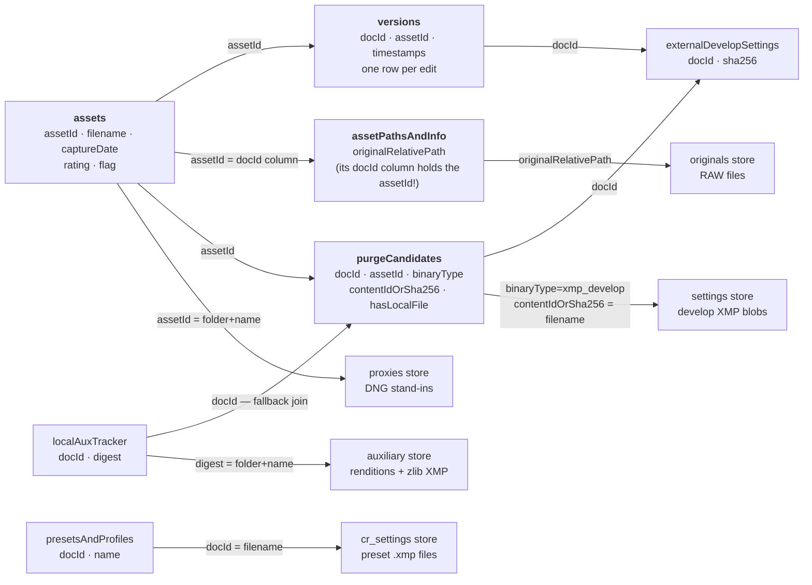
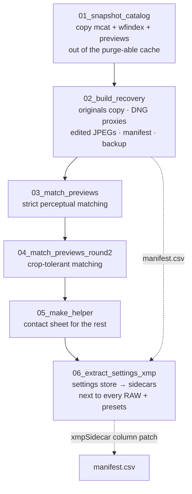
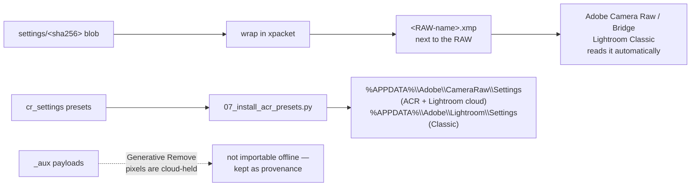

# Data structure diagrams

Mermaid diagrams — GitHub renders them natively. They map how Adobe
Lightroom (cloud) organizes its local data and how the toolkit joins the
pieces back into photos, edits, and presets.

- [1. Local storage layout](#1-local-storage-layout)
- [2. Catalog tables and file stores — the join graph](#2-catalog-tables-and-file-stores--the-join-graph)
- [3. How one photo's edit becomes a sidecar](#3-how-one-photos-edit-becomes-a-sidecar)
- [4. The recovery pipeline](#4-the-recovery-pipeline)
- [5. ACR files vs aux payloads — what is importable](#5-acr-files-vs-aux-payloads--what-is-importable)
- [6. References](#6-references)

---

## 1. Local storage layout

Everything lives under one folder — unencrypted, plain files + SQLite:

```mermaid
flowchart TB
    subgraph ROOT["%LOCALAPPDATA% / Adobe / Lightroom CC / Data / &lt;guid&gt;"]
        subgraph DB["SQLite catalogs"]
            MCAT["Managed Catalog.mcat<br/>document store: docs + revs<br/>content = Adobe-flavored CBOR"]
            WFX["Managed Catalog.wfindex<br/>~60 plain tables — the goldmine<br/>(assets, versions, paths, purge index)"]
            NDB["Managed Catalog.notifdb<br/>notifications (ignorable)"]
        end
        subgraph STORES["content-addressed file stores"]
            ORIG["originals / year / date / *.ARW<br/>1,692 full-resolution RAWs (64 GB)<br/>★★★ the photos"]
            SET["settings / &lt;sha256&gt;<br/>2,648 extensionless blobs<br/>★ per-photo develop XMPs"]
            PREV["previews / &lt;shard&gt; / &lt;key&gt;&lt;suffix&gt;<br/>5,530 JPEG renders, edits baked in<br/>suffix: afa=320px ama=640px baa=2048px"]
            AUX["auxiliary / &lt;digest[:3]&gt; / &lt;digest[3:]&gt;<br/>4,734 mixed: TIFF renditions (02)<br/>+ zlib XMP payloads (uint32 len + 78 9c)"]
            PROX["proxies / 2560 / &lt;aid[:3]&gt; / &lt;aid[3:]&gt;<br/>318 lossy DNG stand-ins<br/>(NOT edited)"]
            CRS["cr_settings / &lt;docId&gt;.xmp<br/>234 user presets"]
            CDEF["cr_defaults, cr_cameraprofiles<br/>raw defaults / camera profiles"]
            EMPTY["xmp, big_table_cache<br/>empty on this machine"]
        end
    end
    DB ~~~ STORES
```

Naming scheme shared by `auxiliary\` and `proxies\`: a 32-hex id is sharded
as `<id[:3]>\<id[3:]>` — the first three characters name the folder, the
rest name the file.

---

## 2. Catalog tables and file stores — the join graph

The core data structure: `wfindex` tables (plain SQL) linked to each other
by three overlapping key-spaces, and to the physical files by digests and
sha256s. Bold row names are the ones that matter most.

Key-space gotchas (all three bite during joins):

| Column | What it actually contains |
|---|---|
| `assets.docId` | INTEGER row id — a *different* space from the hex docIds |
| `assetPathsAndInfo.docId` | the **assetId** (32-hex), not the assets row id |
| `versions.docId`, `purgeCandidates.docId`, `localAuxTracker.docId` | hex docIds — but no single table covers all documents, hence the fallback joins |

`purgeCandidates.binaryType` census — the map of what exists where:

| binaryType | meaning | example count | local |
|---|---|---|---|
| `original` | the RAW file | 1,998 | 1,646 |
| `xmp_develop` | full develop settings | 3,457 | **2,123** |
| `aux` | auxiliary renditions | 5,403 | 4,676 |
| `proxy` | DNG stand-in | 1,998 | 310 |

(`hasLocalFile` is Adobe's own flag for "the blob is on this machine";
`ozHasBinary=1` means Adobe's cloud still has it.)

---

## 3. How one photo's edit becomes a sidecar

The resolution chain the toolkit walks for every edited photo:

The failure mode to remember: Camera Raw silently ignores any sidecar
whose base name is not byte-identical to the photo's — no error, no
warning. That rule drives the whole naming strategy.

---

## 4. The recovery pipeline

Each step is idempotent and standalone (`--data / --work / --out`), so the
pipeline can be resumed from any step after a failure.

---

## 5. ACR files vs aux payloads — what is importable

"ACR file" and "XMP file" are the same thing here — Adobe's own Lightroom
Classic documentation calls these sidecars "XMP/ACR files"
([Create XMP/ACR files in Lightroom Classic](https://helpx.adobe.com/tw/lightroom-classic/desktop/organize-photos-in-lightroom-classic/create-xmp-acr-files.html)).
What Adobe stores per photo **is** the Camera Raw (ACR) develop
representation. Nothing needs converting — the recovered sidecars import
as-is:

| Artifact | Format | Importable? | Where |
|---|---|---|---|
| `settings\`-derived sidecars | crs XMP, masks embedded inline (`MaskGroupBasedCorrections` verified in 120/120 sampled) | ✅ sidecar for ACR / Bridge / Classic | `originals\<year>\<date>\<RAW-name>.xmp` |
| `_unlinked\` orphans | same complete ACR XMP format, photo link lost from the index | ✅ but must be renamed manually to the photo's base name | `xmp-sidecars\_unlinked\` |
| `cr_settings\` presets | ACR preset schema (`crs:PresetType`, `crs:Cluster`) | ✅ copy into the settings folder — `07_install_acr_presets.py` automates it | `presets\` |
| `_aux` XMPs | `crs:RequestInfo/ResponseInfo` records of Adobe's Generative Remove service | ❌ the AI pixels live on Adobe's servers; these are provenance, not settings | alongside their photos |

Settings-folder locations per Adobe's documentation:
ACR and Lightroom share `%APPDATA%\Adobe\CameraRaw\Settings`; Lightroom
Classic uses `%APPDATA%\Adobe\Lightroom\Settings`.

---

## 6. References

- Adobe: **Create XMP/ACR files in Lightroom Classic** — the definitive
  Adobe reference for what "ACR files" are (XMP sidecars written by
  Lightroom, read by Camera Raw) —
  <https://helpx.adobe.com/tw/lightroom-classic/desktop/organize-photos-in-lightroom-classic/create-xmp-acr-files.html>
- Adobe XMP specification and the Camera Raw settings namespace —
  <https://developer.adobe.com/xmp/docs/> · namespace
  `http://ns.adobe.com/camera-raw-settings/1.0/`
- Adobe: XMP metadata / "Save metadata to files" (how sidecars work) —
  <https://helpx.adobe.com/lightroom-classic/help/metadata-basics-actions.html>
- Adobe: Camera Raw presets and the settings folder location —
  <https://helpx.adobe.com/camera-raw/using/presets.html>
- Adobe: what happens when a Creative Cloud membership ends —
  <https://helpx.adobe.com/creative-cloud/help/creative-cloud-membership-basics.html>
- RFC 8949 — Concise Binary Object Representation (CBOR), the family the
  catalog's document blobs belong to —
  <https://www.rfc-editor.org/rfc/rfc8949>
- Couchbase Lite — the mobile database whose docs + revisions storage model
  the Managed Catalog mirrors —
  <https://docs.couchbase.com/couchbase-lite/current/introduction.html>
- The Lightroom Queen: what XMP data is and how Lightroom uses it —
  <https://www.lightroomqueen.com/what-is-xmp-data/>
